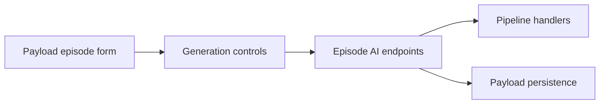
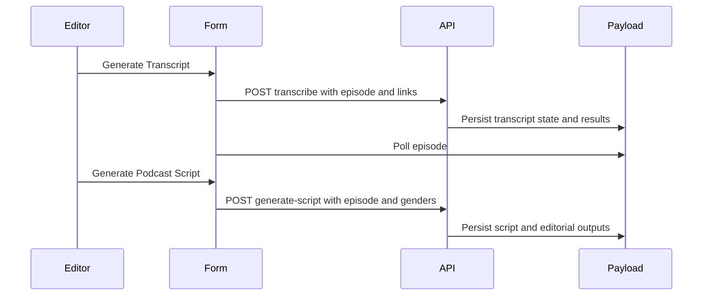

## Architecture Analysis

### System Overview
One Next.js/React application hosts the Payload portal and public site. Payload collection metadata defines episode fields; custom React fields initiate and poll separate transcript, script and audio operations.

### Architectural Style
Modular application with collection hooks and provider adapters. PodcastEpisodes hooks reconcile video rows, validate thumbnails and synchronize AI fields into public content fields. Unnamed collapsibles organize fields without introducing stored object paths.

### Component Relationships

<!-- Text fallback: The episode form contains generation controls that call episode endpoints, which invoke pipeline handlers and persist results through Payload. -->

### Data Flow
Transcript controls save links and request transcription; script controls use the saved source transcript and selected genders. Both poll episode state every three seconds. Audio uses stored script and voice IDs. See api-documentation.md.

### Key Design Decisions
Existing storage is flat despite collapsible presentation. Preserve field names and ID selectors when regrouping controls. The transcript endpoint already excludes script generation.

### Improvement Opportunities
The requested section separation can clarify the existing independent operations. This scan proposes no new generation behavior or provider changes.

## Interaction Diagrams

<!-- Text fallback: The editor generates a transcript first, waits for persisted results, and separately generates the podcast script and editorial outputs. -->
